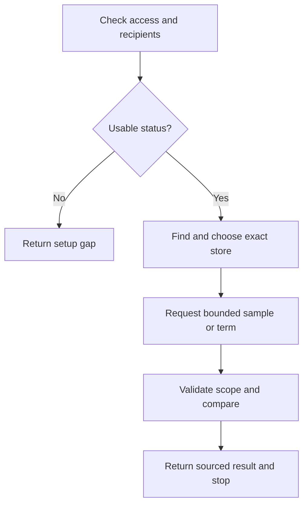

# Find and compare promotions at an exact store

Return the requested bounded comparison using real app results, with the right
store and the limits visible.

## Continued From

`SKILL.md` shopping route, or setup with a current accepted installation.
Direct entry accepts an existing valid store choice and access context.

## Resources

Before catalog requests, read `references/source-permissions.md` in full. Before
the first app request, read `references/api_reference.md` and
`research/official_docs/pages/API.md` in full. Before the final report, read
`schemas/output-contract.md` in full. For a browser route, read
`research/official_docs/pages/USER_GUIDE.md` in full and use the host's actual
browser-tool contract, including its session/privacy rules.

## Step 1: Accept the installation and permitted data channel

Confirm the user-selected base URL and actual recipients. Reuse established
permission when its scope and recipients still match. If forwarding to this
agent/provider is unresolved, do not request catalog data through a tool that
would expose it; return the permission gap and permitted human-use guidance.

Use `GET api/v1/status` relative to the full base URL. It returns installation
readiness without contacting Kroger or returning catalog payloads. A false
`configured` status goes to setup. A true value only proves settings exist;
search success is separate evidence. Mark certification or synthetic results.

Complete when the installation, response format and permitted channel are known.

## Step 2: Resolve the person's exact store

Get the ZIP through an allowed input channel. Send
`POST api/v1/stores/search` with only `zipCode` as a five-digit string, preserving
leading zeros. Keep inputs in JSON bodies, never URL queries.

Present full returned names, addresses and store IDs through the permitted
channel. Ask the user to choose when more than one location remains plausible;
do not choose the first result or assume ZIP identifies one store. An empty list
means no matches in this bounded search, not no stores anywhere.

An already supplied exact store can skip discovery if its identity is verified
for this installation. A changed store invalidates every prior offer response.
Complete when the exact eight-character `locationId` is accepted.

## Step 3: Load a bounded sample or requested term

Send `POST api/v1/deals/search` with the accepted `locationId`. Omit `term` for
the starter sample: milk, bread and eggs, at most 15 products each. For a requested
grocery or brand, send `term` with 3–80 characters and at most eight words; one
page requests at most 50 products. Do not send an empty `term` string.

Default `sort` to `savings`; `percent` and `price` are the other supported
values. Use one bounded request, not pagination, department sweeps or repeated
scans to simulate a complete promotion feed. Record `dataSource`, environment,
`retrievedAt`, `scope`, summary and response identity.

On failure, follow the typed error and recovery reference. Respect `Retry-After`.
A read failure does not authorize a rapid retry loop. Complete when a successful
response or an explicit bounded failure is known.

## Step 4: Verify scope before comparing

Require `ok: true`, supported API version and `scope.locationId` matching the
current accepted store. Discard stale store/query responses. Confirm mode,
topics, limits and `exhaustive: false`; do not call these results all promotions.

Keep full source description, item/package identity and current price pair.
Explain `calculated.savingsCents` and `percentOff` as calculations against the
current regular price. Rank only returned qualifying offers. The web page uses
the shared ordering helper locally; an HTTP-only client can choose one server
sort or apply the documented comparator to already received data, without a new
upstream query solely to rerank it.

Show either supplied per-unit estimate at its precision. Missing basis stays
unknown; size/sold-by strings do not supply a standardized measure. Inspect each
offer's history, not only provider availability. Differentiate pending permission,
no observations, insufficient/incompatible history, failed reads, and environment
mismatch. Use dated prior values and source labels only when actually supplied;
qualified deltas must be non-null and context-compatible.

An empty offer list is a successful bounded result. Current regular prices,
sample fixtures and missing data never become historical observations.

## Step 5: Return the comparison and finish

Use the output contract. Say which store, retrieval time, topics and ranking the
answer covers. Include complete descriptions for every offer actually reported;
if only a requested top subset is shown, state its count and the returned total.
Never silently shorten the result set or source descriptions.

Mark stock advisory and reconfirmation needs. When history or unit comparison is
unavailable, preserve that limit alongside useful current prices. Do not save
catalog/search data or send it to another recipient without the applicable
source and user authority. Stop after the requested result.

## Gotchas

- One ZIP can return multiple stores; one product can have multiple item offers.
- Lowest selling price is not necessarily lowest normalized unit price.
- `history.observationCount: 0` under `permission_required` is not a completed
  history lookup. `history_read_failed` is not evidence of an empty database.
- Certification results never establish production shopping prices or history.

## Checklist

- [ ] Source recipients and the exact store are permitted and accepted.
- [ ] Response store/query/scope match the current request.
- [ ] Source facts, calculations, test status and missing evidence remain clear.
- [ ] No unrequested purchases, collection, persistence or forwarding occurred.

## Recovery from interruption

Resume from the earliest invalidated step. Recheck environment and permission
scope; reuse a store choice only if it still matches. Treat old prices as a dated
prior response, not a newly refreshed quote. Do not recreate previous searches
from private logs. Cancellation stops local waiting and does not prove an
already sent request was never received.

## Handoff

Producer: shopping procedure. Receiver: caller. Deliver the accepted store,
scope, observation time, sourced comparison, actual checks and remaining gaps.
The caller verifies those meanings before acting. Return connection problems to
`playbooks/setup-and-recovery.md`, store ambiguity to the user and permission
questions to the appropriate authority. Stop after the requested bounded result.
