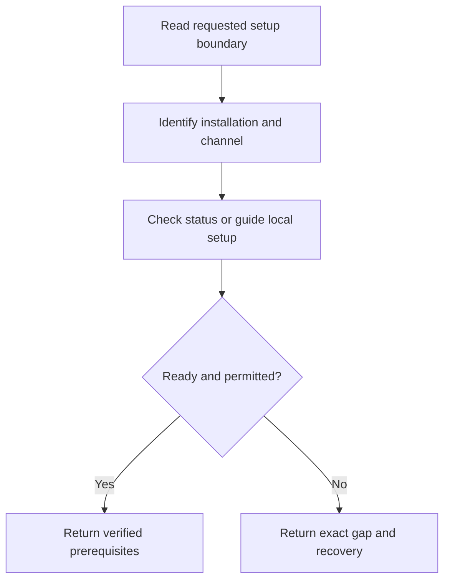

# Establish a usable installation or explain its blocker

Guide setup or recovery without exposing credentials or presenting a configured
installation as live-qualified.

## Continued From

`SKILL.md` setup route or a typed connection failure from shopping. Setup-only
requests finish here; working setup does not authorize a new shopping search.

## Resources

Before guiding installation, read `references/user-guide.md` in full. Before API
status or error handling, read `research/official_docs/pages/API.md` in full.
Before handling a catalog-processing permission question, read
`references/source-permissions.md` in full. Before local app configuration, read
`research/official_docs/pages/SELF_HOSTING.md` in full; it owns actual commands.

## Step 1: Bound the requested help

Establish whether the person wants skill installation, app installation,
connection diagnosis or a shopping comparison. Get the actual installation URL;
do not infer that a proposed hosted address exists. Check which HTTP/browser
capabilities the host actually exposes. If it cannot read skills or make the
permitted requests, give manual human-use instructions and name that gap.

Complete when the requested effects and available channel are explicit.

## Step 2: Guide installation or inspect existing status

For a new local app, give the ordered self-hosting steps and expected setup
notice. Node/npm and the database adapter belong to that app, not to an AI
provider. Use the real host/runtime checks before claiming an installation ran.

Credentials are configured privately by the operator on the server. Do not ask
for a client secret in chat, read `.env`, inspect filled account pages, put
credentials in command arguments or change API registrations as routine setup.
For an existing app, issue only its documented status request and inspect the
minimal response. Distinguish unreachable, unconfigured, certification and
configured-but-unverified states.

Complete when the actual status is known or a concrete unavailable prerequisite
has been returned. Instructions supplied to the person are not completed setup.

## Step 3: Recover according to the actual failure

| Condition | Action |
|---|---|
| `setup_required` | Operator completes API configuration, then checks again. |
| Rejected connection/permission | Operator checks environment, scope and application access privately. |
| Invalid request/input | Correct the documented field once; keep exact IDs as strings. |
| Busy/quota response | Respect the supplied delay; do not restart or loop to bypass limits. |
| Unexpected/oversized/upstream failure | Explain the failure; retry only with a changed input or a later bounded attempt. |
| History permission pending | Current prices may still work; no collector or history claim follows. |
| History read failed | Preserve current prices and the unknown history; do not report zero observations. |
| History environment mismatch | Keep sandbox prices separate from production history. |

Use the exact current API reference for additional error categories. Preserve
unknown outcomes rather than inventing responses. Complete when the smallest
useful corrective action or verified recovery has been provided.

## Step 4: Return readiness and stop or resume

State which checks actually ran and whether any catalog access was permitted.
For a setup-only request, stop. For an interrupted shopping request, return the
current base URL, environment, accepted transport/recipient scope and unresolved
inputs to the shopping procedure; it verifies those prerequisites before use.

## Gotchas

- `configured: true` is a settings-presence check, not a successful live search.
- The skill needs no AI-provider account, API key or provider-specific metadata.
- Original project materials use the repository's MIT LICENSE. Local source
  files and this guide do not establish a public release or deployment.

## Checklist

- [ ] The actual installation and requested effects were established.
- [ ] No private credentials/account records entered agent context.
- [ ] Instruction, executed setup, status and live access were distinguished.
- [ ] The resolving owner and next action are clear.

## Recovery from interruption

Inspect current permitted status before repeating setup. Preserve user-owned
processes, accounts and files. Never replay an uncertain registration or replace
an existing database merely to make setup pass. Resume only the affected check.

## Handoff

Producer: setup procedure. Receiver: caller, or shopping only when that task is
already authorized. Deliver current installation identity, actual checks,
permitted data channel and missing dependencies. The receiver accepts those
facts before use; missing authority returns to its decision owner. Stop when
the requested setup result or precise blocker has been delivered.
